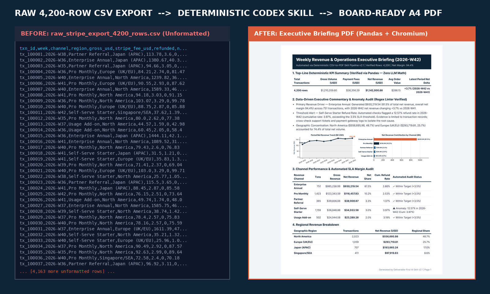

# Deliverable-First AI Skill (v2.2): Raw CSV to Board-Ready Executive PDF

Turn raw transaction CSV exports (Stripe, Shopify, or SaaS logs) into a verified, 1-page A4 Executive Briefing PDF using deterministic `pandas` math, strict input validation, regex vocabulary linting, and Headless Chromium vector compilation.



The bundled PDF and comparison images are v2.1 examples; generate fresh outputs for v2.2 terminology.

## How v2.2 Enforces Financial & Layout Integrity

1. **Strict Input & Accounting Validation (Zero Silent Coercion):**
   - **No Silent Mock Fallback:** Passing a non-existent `--input` file fails immediately with `FileNotFoundError` (exit code `2`). Synthetic demo data is only generated when `--demo` is explicitly passed.
   - **No Silent Zero-Coercion:** Unparseable numeric values or `NaN` cells raise a `ValueError` citing the exact row index. Boolean refund flags (`0/1`, `true/false`, `yes/no`, `y/n`, `refunded/paid`, `是/否`, `已退款/未退款`) are strictly mapped; unknown labels fail fast.
   - **Explicit Accounting Opt-Ins:** Fee and refund columns are required by default. Estimating fees (`2.9% + $0.30`) or assuming zero refunds requires explicit CLI flags (`--estimate-missing-fees`, `--assume-zero-refunds`).
2. **Chronological Period Parsing & Consistent PoP States:**
   - Parses ISO weeks (`2026-W9`, `2026-W10`), months (`YYYY-MM`), quarters (`YYYY-Qq`), and dates (`YYYY-MM-DD`) into chronological tuples so `2026-W10` always sorts after `2026-W9`.
   - When prior-period net revenue is `<= $0` or only a single period exists, `wow_net_delta` is set to `null` and reported consistently as `N/A (not calculable)` across JSON, KPI tables, and executive prose (never outputting a contradictory `+0.0%`).
3. **Evidence-Bounded Commentary & Regex Vocabulary Linter:**
   - Executive bullets are dynamically assembled from `summary_metrics.json` (covering Top Channel, Net Realization Rate, Period-over-Period Delta, Refund SLA Breaches, and Geographic Concentration) without fabricating root causes outside the CSV.
   - Built-in regex linter (`lint_executive_copy`) scans output against the banned vocabulary list in `anti_ai_style_guard.md`.
4. **Top-N Table Aggregation & Hard PDF Page-Budget Verification:**
   - Channels and regions beyond `--max-table-rows 6` are automatically grouped into `"Other (N segments)"` to prevent table overflow.
   - Headless Chromium compiles the vector PDF and `pypdfium2` verifies the final page count against `--max-pages 1`. Missing browser dependencies or page-budget overflows exit with code `2` (unless `--allow-html-only` is explicitly passed).

## System Requirements

- **Python 3.10+** with `pandas`, `numpy`, `matplotlib`, `pillow`, `pypdfium2`, `selenium`
- **Google Chrome or Chromium** + matching **ChromeDriver** on `PATH` (required for native PDF compilation; pass `--allow-html-only` in environments without a browser).

## Quick Start

### 1. Run the Automated Audit Test Suite
```bash
python3 test_pipeline_audit.py
```

### 2. Run End-to-End Synthetic Demo (`--demo`)
```bash
pip install pandas numpy matplotlib pillow pypdfium2 selenium

# English Demo (4,200 rows -> JSON -> Linter -> Charts -> HTML -> 1-Page PDF -> X Card)
python3 csv_to_pdf_pipeline.py --demo

# Chinese/CJK Demo
python3 csv_to_pdf_pipeline_zh.py --demo
```

### 3. Run on Your Real Business CSV
```bash
python3 csv_to_pdf_pipeline.py \
  --input /path/to/orders.csv \
  --col-id order_id \
  --col-period billing_week \
  --col-channel channel \
  --col-region region \
  --col-gross gross_amount \
  --col-fee gateway_fee \
  --col-refund is_refunded \
  --col-refund-amount refunded_amount \
  --derive-net-from-gross \
  --refund-threshold 3.5 \
  --max-table-rows 6 \
  --max-pages 1 \
  --output-pdf weekly_briefing.pdf
```
If the CSV does not contain the default `net_usd` column, use `--col-net` to select an existing net column or explicitly pass `--derive-net-from-gross`. Net is derived as gross minus fees minus the actual refund amount. When any row is marked refunded, `--col-refund-amount` is required and must identify a nonnegative refund amount column consistent with the flags. This assumes fees and refund amounts are recorded on the same row and accounting period; cross-period refunds, returned fees, taxes, and other adjustments require a supplied net column or upstream reconciliation.

Net realization rate is net revenue divided by gross volume, typically gross less fees and refunds; it excludes operating overhead, COGS and taxes. Supplied net amounts follow the source accounting definition.

For net reports, missing fees or refund flags require explicit assumptions (`--estimate-missing-fees` or `--assume-zero-refunds`). These assumptions are labeled in the report and are not evidence of observed refund compliance. The built-in fee estimate is USD-only.

### 4. Report sales when fees and refunds are unknown

```bash
python3 csv_to_pdf_pipeline.py \
  --input sales.csv \
  --col-gross gross_gbp \
  --currency GBP \
  --report-basis gross \
  --report-note "UCI Online Retail: positive sales invoices; cancellations excluded. Segment is a dataset classification, not a marketing channel." \
  --output-pdf sales_briefing.pdf
```

The CSV must also contain `txn_id`, `week`, `channel`, and `region`, or map them with `--col-*`. Aggregate invoice lines to one row per invoice before reporting invoice counts. In gross mode, absent fee, refund and net columns remain unavailable (`null` in JSON and “Not provided” in the PDF). Do not insert placeholder zero columns: supplied zeros are treated as observations. No refund health conclusion is generated for unavailable or assumed refund flags. Supplied financial columns still receive strict validation.

`--currency` supports USD, GBP, EUR, CNY and JPY. It labels amounts without currency conversion; all rows must use that currency. Legacy default column names ending in `_usd` are retained for compatibility; map the actual amount column with `--col-gross`. Both language entry points require the adjacent `report_support.py` module. Long segment names wrap instead of being truncated. `--report-note` records source, date range and exclusions in the PDF.

## License
MIT License — see [LICENSE](LICENSE).

Required transaction IDs, period, segment and region cannot be blank; IDs must be unique after trimming. Aggregate line items upstream if a transaction spans multiple rows. Monetary inputs must be finite, within ±1,000,000,000,000, and have no more than two decimal places. Amount sums and net derivation use decimal arithmetic; percentage calculations use floating point. Output currency labels do not convert amounts.

Comparison cards hide source CSV rows and filenames by default. They still contain a thumbnail of the generated report, which may include sensitive aggregated business information; review it before sharing. Existing cards generated by older versions can contain source data and should be handled accordingly.
